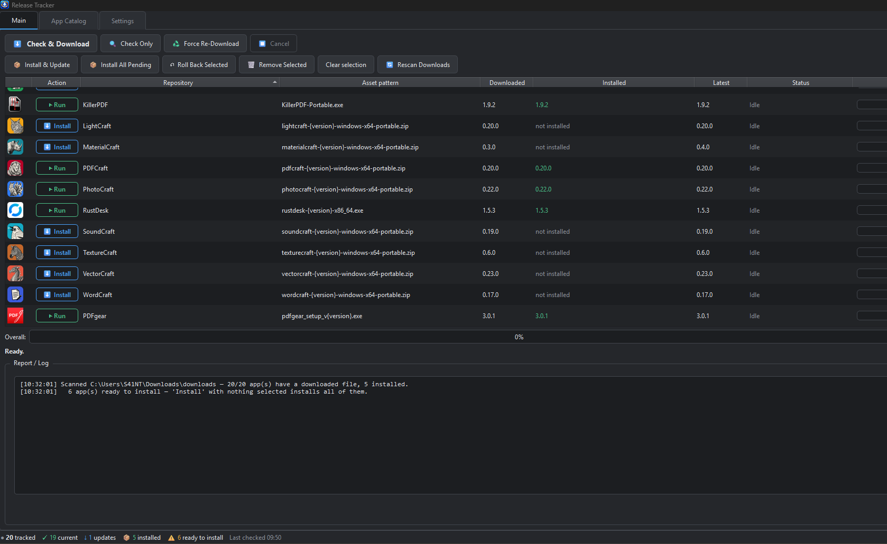

# Release Tracker



A Windows-friendly desktop app (Python + PySide6) that keeps a list of software you care about, checks each one for a newer release, downloads it, and updates your local copy, with backups and one-click roll back.

It is built for **portable apps**: point it at a project's release page, tell it which file to grab (for example the Windows x64 portable zip), give it an install folder, and the tracker does the rest.

---

## Features

### Tracking and checking
- **One-click check.** *Check & Download* checks every tracked app and downloads anything newer, with per-app progress bars, an overall bar and a full report/log. *Check Only* just reports; *Force Re-Download* fetches again.
- **Many source types**
  - GitHub releases
  - Gitea / Forgejo / Codeberg (including self-hosted)
  - Blender's official download server
  - Any web page, scanned for download links with a file pattern
  - A *direct "latest" link* that redirects to the newest file
  - A *version page + download template* for sites that hide their links (a regex reads the version from a page, and a template such as `app_setup_v{version}.exe` builds the file address)
- **Asset patterns.** Pick the file you want once; the pattern (`{version}` = version number, `*` = wildcard) is reused for every future release.
- **Pre-releases** can be included or ignored (setting).
- **Checksum verification.** When the release page publishes a SHA-256 value, the download is verified against it (setting).
- **Optional GitHub token** raises GitHub's API rate limit from 60 to 5,000 requests per hour.

### Installing and updating
After a download the tracker can ask which apps to install, install automatically, or do nothing (setting). Each app has its own install method:

| Method | Use for |
|---|---|
| Auto | Decides by file type |
| Extract archive | zip / 7z / rar / tar |
| Copy file | A single portable `.exe` |
| Self-extracting `.exe` | Extracted with 7-Zip |
| Mozilla installer | Keeps only the `core` folder (Firefox / Thunderbird setup files) |
| Inno Setup unpack | Unpacks the installer with `innounp`, nothing is installed |
| Run installer | Runs a setup program with arguments (`{dest}` = install folder) |
| MSI | Extracts the files only, no system install |

Safety and control options:
- **Update mode:** *merge* (keeps your settings and extra files) or *clean replace*.
- **Protect list:** files and folders that are never overwritten (for example `*.ini; settings.json; data/`).
- **Top-folder handling:** removes the single wrapper folder many zips contain.
- **Portable markers:** files such as `portable.txt` created after every install.
- **Backups and roll back:** keep the last 0–5 versions per app and roll back from the Main tab.
- **Locked-file handling:** detects apps that are running from an install folder.
- **Run arguments:** command-line arguments for the Run button and shortcuts (for example a profile or config folder).

### Main tab
Per-app status, latest version, installed version, pattern and install location, plus **Run** and **Install** buttons on each row, Install All Pending, Roll Back Selected, Open Downloads / Install Folder, Rescan Downloads, Remove Selected, a context menu, sortable columns, and the report log.

### App Catalog tab
A curated, editable catalog of ready-made entries (`app_catalog.json`, 300+ apps in categories such as Developer, Emulators, Graphics & design, Network & remote, Local AI, Media players, Security and more).
- Filter by category, select several apps and click **Add Selected to Tracker**.
- Entries arrive with the source, asset pattern, install method, protect list and notes already filled in.
- Apps already tracked are marked in the catalog.
- **Edit app_catalog.json** and **Reload catalog** let you add your own entries or fix existing ones.
- On a first start with nothing tracked, the tracker adds the *storytold Craft* suite as starter apps (tracked only; nothing is downloaded until you click).

### Settings tab
Add or edit a source (URL, source type, version regex, download template, asset pattern) and its install options. Edits to an app are **saved automatically**. Global options include the download folder, a default install folder, 7-Zip and `innounp` paths, the after-download behaviour, backups per app, SHA-256 checking, pre-releases, the GitHub token and API toggle, and the theme (**System**, **Dark** or **Light**). Window size and position are remembered.

### Command line / Task Scheduler
Run without a window and log to `auto_update.log` (rotated at 2 MB):

```
ReleaseTracker.exe --auto            check + download + install updates
ReleaseTracker.exe --download-only   check + download only
ReleaseTracker.exe --check-only      report only
ReleaseTracker.exe --install-only    install already-downloaded updates
```

Options: `--close-running` (close apps that are running from an install folder; the default is to skip them), `--config <repos.json>`, `--log <file>`.
Exit codes: `0` OK, `1` errors, `2` already running. A lock file stops two instances (or a scheduled run and the window) from running at once.

---

## Requirements

- Python 3 and **PySide6**: `pip install PySide6`
- Optional: **7-Zip** (for `.7z`, `.rar` and self-extracting files), **innounp** (Inno Setup unpacking), **psutil** (faster running-app detection)

## Run it

```
pip install PySide6
python release_tracker.py
```

To use the command-line modes from source: `python release_tracker.py --auto`.

### Build an EXE (optional)
Any PyInstaller build works. Example:

```
pip install pyinstaller
pyinstaller --onefile --windowed --name ReleaseTracker --icon icon.ico release_tracker.py
```

If an `icon.ico` sits next to the program (or is bundled), it is used as the app icon. When a freshly built EXE is still in `dist\`, the tracker uses the project folder's `repos.json`.

## Files it creates (next to the script or EXE)

| Path | Purpose |
|---|---|
| `repos.json` | Your tracked apps and settings |
| `app_catalog.json` | The App Catalog (ships with the project, editable) |
| `downloads/<app>/` | Downloaded release files (folder can be changed in Settings) |
| `backups/` | Backups used for roll back |
| `cache/` | Cached icons and UI assets |
| `auto_update.log` | Log from command-line runs |
| `releasetracker.lock` | Prevents two instances running at once |

## Adding an app (quick start)

1. Open **Settings**, paste a release page URL (for example `https://github.com/owner/project/releases`) and click **Fetch Assets**.
2. Pick the file you want (or type an asset pattern such as `project-{version}-windows-x64-portable.zip`).
3. Set an install folder and install method, then click **Add / Update Repository**.
4. On **Main**, click **Check & Download**.

Or open **App Catalog**, tick the apps you want and click **Add Selected to Tracker**.

## Notes and limits

- **GitHub rate limits.** Without a token GitHub allows 60 API requests per hour per IP address. If many apps use the API, add a token in Settings or switch affected apps to a web-page source.
- **Installer-type entries** (*Run installer*) can leave registry entries, file associations or shortcuts that the tracker cannot undo or back up.
- Catalog entries marked unverified have not been tested on every machine. Run *Fetch Assets* once after adding one.
- Windows is the primary target. Some folder-opening code has macOS and Linux fallbacks, but the install features are built around Windows portable apps.

## License

MIT license.
